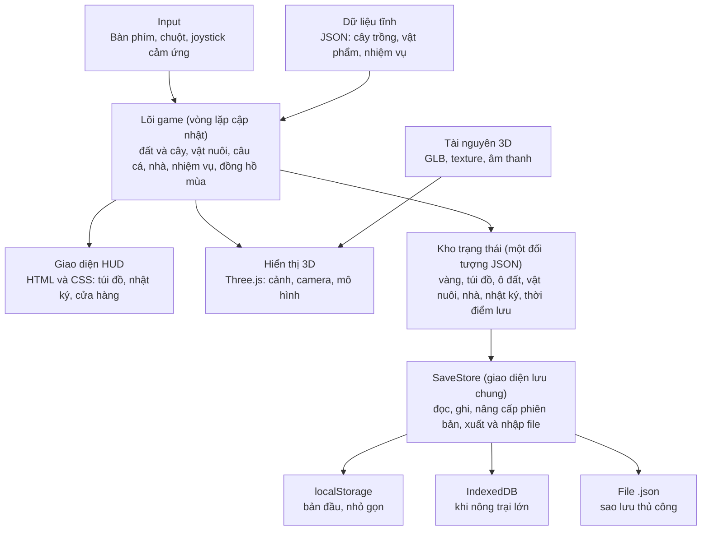
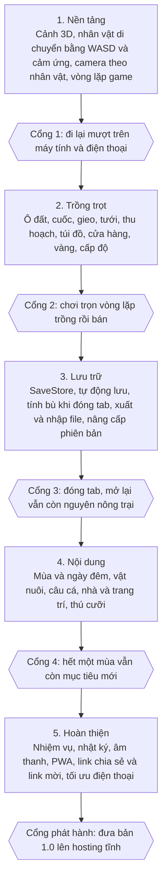

# Cozy Farm – Tài liệu thiết kế game (không backend)

> File này dùng để đưa cho Claude Code trong VS Code. Hãy đọc hết trước khi viết code.

## 0. Ghi chú cho Claude Code

- Nhiệm vụ: dựng game nông trại 3D chạy hoàn toàn trên trình duyệt, **không có backend**.
- Đã chốt: 3D bằng Three.js, TypeScript, Vite; giao diện có tiếng Việt và tiếng Anh; dùng bộ tài nguyên miễn phí (Kenney, Quaternius, CC0); lưu bằng localStorage rồi IndexedDB; không cookie; không server.
- Việc làm theo thứ tự ở mục 9 (giai đoạn 1 đến 5). Chưa sang giai đoạn kế khi chưa qua cổng kiểm tra của giai đoạn trước.
- Mọi lớp lưu trữ phải đi qua giao diện `SaveStore` (mục 5) để sau này thêm backend không phải sửa logic game.
- Các con số cân bằng ở mục 7 là giá trị khởi điểm, chưa được thử chơi; đặt chúng trong `src/data/*.json` để dễ chỉnh.
- Còn mở: danh sách tính năng của web cũ cần giữ lại (người dùng sẽ bổ sung).
- Tham chiếu: https://cozyfarmy.com (chỉ đọc được phần HTML bên ngoài, xem mục 2).

## 1. Tổng quan

**Cozy Farm là game nông trại 3D thư giãn chạy hoàn toàn trên trình duyệt, không cần server: toàn bộ tiến trình được lưu ngay trên máy người chơi.**

| Mục | Nội dung |
| --- | --- |
| Thể loại | Farming sim 3D, nhịp chậm, không áp lực thua |
| Nền tảng | Trình duyệt desktop và mobile (WebGL) |
| Đối tượng | Người chơi casual, thích game thư giãn kiểu Stardew Valley |
| Phong cách | Low-poly 3D, màu ấm, nhạc nhẹ |
| Mô hình | Miễn phí, không đăng nhập, không backend |
| Lưu trữ | localStorage và IndexedDB trên trình duyệt |
| Công nghệ | Three.js, TypeScript, Vite |

**Trụ cột thiết kế**

- Thư giãn: không có đếm ngược gây áp lực, cây không chết khi người chơi vắng mặt.
- Vòng lặp ngắn: một phiên 5 đến 10 phút vẫn có tiến triển rõ ràng.
- Nhẹ và tải nhanh: mục tiêu dưới 15 MB tài nguyên, chạy được trên điện thoại tầm trung.
- Dữ liệu thuộc về người chơi: có xuất và nhập file lưu để sao lưu hoặc chuyển máy.

**Phạm vi bản không backend:** không có tài khoản, không bảng xếp hạng toàn cục, không thăm nông trại bạn theo thời gian thực. Phần xã hội được thay bằng mã chia sẻ (mục 8).

## 2. Phân tích tham chiếu: cozyfarmy.com

**Chỉ phần HTML bên ngoài của trang đọc được; logic game chạy bằng JavaScript nên phần còn lại là suy đoán.** Khi có mã nguồn của bản cũ, cần đối chiếu lại mục này.

| Nhóm | Điều đã đọc được từ trang | Độ chắc |
| --- | --- | --- |
| Mô tả | Nông trại 3D trên trình duyệt: trồng cây theo mùa, câu cá ở hồ lớn, nuôi gà, lợn, bò, trang trí căn hộ, thăm nông trại bạn bè | Chắc chắn (meta mô tả) |
| Tiền tệ | Vàng; link mời tặng 500 vàng | Chắc chắn |
| Điều khiển | WASD di chuyển, Space/click dùng, E tương tác, R cưỡi, F ăn, I túi đồ, J nhật ký, Esc menu | Chắc chắn (dòng hướng dẫn trên trang) |
| HUD | Biểu tượng nông dân kèm số (có thể là cấp độ), nút Social, nút túi đồ | Chắc chắn về thành phần, suy đoán về ý nghĩa số |
| Kỹ thuật | Cần WebGL; có meta cho mobile web app, chặn zoom, màu theme #7a4a22 | Chắc chắn |
| Loại 3D | Không rõ dùng Three.js hay Babylon.js | Chưa biết |
| Backend | Có lẽ có (link mời, thăm bạn gợi ý có tài khoản); chưa xác minh | Suy đoán |
| Cân bằng game | Giá cây, thời gian lớn, các mùa, nhiệm vụ | Chưa biết, tự thiết kế ở mục 7 |

**Điểm khác biệt của bản mới:** bỏ đăng nhập và server, thay link mời bằng mã chia sẻ, thêm xuất và nhập file lưu.

## 3. Gameplay và các hệ thống

**Vòng lặp cốt lõi: trồng, chăm sóc, thu hoạch, bán, dùng vàng mở rộng nông trại, rồi quay lại trồng.** Các hệ thống phụ (nuôi thú, câu cá, trang trí) đều đổ thêm nguồn thu nhập hoặc lý do chi tiêu vào vòng lặp này.

### 3.1 Đất và cây trồng

- Nông trại chia thành ô đất; mỗi ô có trạng thái: cỏ, đất đã cuốc, đã gieo, đã tưới, chín.
- Ba thao tác: cuốc đất, gieo hạt, tưới nước. Đến cuối mỗi giai đoạn lớn, cây phải được tưới một lần mới sang giai đoạn kế; chưa tưới thì cây chờ.
- Cây lớn theo thời gian thực, tính bằng dấu thời gian (mục 6.4), nên vẫn lớn khi người chơi đóng tab.
- Cây chín không héo; thu hoạch lúc nào cũng được.
- Mỗi loại cây thuộc một hoặc nhiều mùa. Sai mùa thì không gieo được; đổi mùa thì cây sai mùa ngừng lớn nhưng không chết.

### 3.2 Mùa và thời gian

- Một ngày trong game dài 12 phút thật, có chu kỳ sáng, chiều, tối và đêm.
- Một mùa gồm 7 ngày trong game (84 phút thật); một năm gồm 4 mùa.
- Thời gian trong game chạy khi mở tab. Khi đóng tab, chỉ cây trồng và vật nuôi được tính bù theo thời gian thật; đồng hồ ngày và mùa dừng lại.
- Mùa đổi màu cỏ, lá cây và bầu trời; mùa đông có tuyết rơi.

### 3.3 Vật nuôi

- Ba loài khởi đầu: gà (trứng), lợn (nấm truffle), bò (sữa).
- Mỗi con có thanh no và thanh vui. Cho ăn mỗi ngày thì sản phẩm đều; bỏ đói thì ngừng sản xuất nhưng không chết.
- Cần chuồng: mua và nâng cấp bằng vàng, mỗi cấp tăng sức chứa.
- Bò có thể cưỡi sau khi thuần (phím R), tăng tốc độ di chuyển.

### 3.4 Câu cá

- Hồ lớn ở rìa nông trại. Thả cần, chờ phao chìm, bấm đúng lúc trong vòng 1 giây.
- Mini-game kéo cá: giữ thanh nằm trong vùng di chuyển của cá. Cá hiếm có vùng nhỏ và nhanh hơn.
- Cá khác nhau theo mùa và giờ trong ngày; có sổ sưu tầm cá trong nhật ký.

### 3.5 Nhà và trang trí

- Căn hộ là một phòng, đặt đồ nội thất theo lưới, xoay 90 độ.
- Đồ nội thất mua bằng vàng, một số mở khoá theo cấp độ hoặc nhiệm vụ.
- Trang trí không ảnh hưởng chỉ số, chỉ là mục tiêu dài hạn và để khoe qua mã chia sẻ.

### 3.6 Chỉ số, ăn uống, cấp độ

- Thể lực giảm khi làm việc; ăn (phím F) để hồi. Hết thể lực thì đi chậm, không bị phạt nặng hơn.
- Kinh nghiệm nhận từ trồng, thu hoạch, câu cá, nuôi thú. Lên cấp mở khoá hạt giống, vật phẩm, ô đất mới.

### 3.7 Nhiệm vụ và nhật ký

- Nhật ký (phím J) gồm: nhiệm vụ đang làm, sổ cá, sổ cây, thành tựu.
- Nhiệm vụ mở đầu hướng dẫn người chơi qua từng hệ thống, sau đó là nhiệm vụ hằng ngày với phần thưởng nhỏ.

## 4. Điều khiển, camera và giao diện

**Người chơi đi tự do trong thế giới 3D bằng WASD trên máy tính và joystick ảo trên điện thoại, cùng một bộ hành động cho cả hai.**

| Hành động | Bàn phím, chuột | Cảm ứng |
| --- | --- | --- |
| Di chuyển | WASD hoặc mũi tên | Joystick ảo bên trái |
| Dùng công cụ | Space hoặc click | Nút hành động lớn bên phải |
| Tương tác (nói chuyện, mở cửa, thu hoạch) | E | Nút tương tác hiện khi đứng gần |
| Cưỡi bò | R | Nút cưỡi hiện khi đứng gần |
| Ăn | F | Chạm vào thanh thể lực |
| Túi đồ | I | Biểu tượng túi |
| Nhật ký | J | Biểu tượng nhật ký |
| Menu | Esc | Biểu tượng menu |
| Đổi công cụ | 1 đến 9 hoặc cuộn chuột | Chạm vào thanh công cụ |

**Camera:** góc nhìn thứ ba, nghiêng khoảng 45 độ, đi theo nhân vật mượt. Cuộn chuột hoặc chụm hai ngón để zoom trong khoảng giới hạn; xoay camera bằng chuột phải hoặc kéo một ngón ngoài joystick.

**Màn hình HUD**

- Góc trên trái: chân dung, cấp độ, thanh kinh nghiệm, thanh thể lực.
- Góc trên phải: vàng, ngày, mùa, giờ trong game, thời tiết.
- Dưới giữa: thanh công cụ 9 ô.
- Góc dưới phải: nút Social (mã chia sẻ), túi đồ, nhật ký, menu.
- Giữa màn hình: gợi ý tương tác khi đứng gần vật thể.

**Mobile:** chặn zoom trang, chỉ dùng chế độ ngang, tự giảm độ phân giải render khi khung hình dưới 40 FPS, và có nút bật chế độ tiết kiệm pin.

## 5. Kiến trúc kỹ thuật

**Game chạy hoàn toàn trong trình duyệt: lõi game cập nhật một kho trạng thái duy nhất, còn hiển thị, giao diện và lưu trữ chỉ đọc hoặc ghi kho này.**



Mũi tên chỉ hướng tác động: người chơi điều khiển qua Input, lõi game cập nhật kho trạng thái, và SaveStore là nơi duy nhất ghi ra localStorage hoặc IndexedDB. Nhờ vậy đổi cách lưu không phải sửa logic game.

### 5.1 Công nghệ

| Phần | Lựa chọn | Lý do |
| --- | --- | --- |
| Ngôn ngữ | TypeScript | Bắt lỗi sớm khi dữ liệu lưu thay đổi |
| Build | Vite | Khởi động nhanh, đóng gói tĩnh |
| 3D | Three.js | Phổ biến, nhiều tài liệu và ví dụ |
| Giao diện | HTML và CSS đè lên canvas | Dễ làm menu, túi đồ, chữ tiếng Việt |
| Âm thanh | Howler.js hoặc Web Audio | Phát nhạc nền và hiệu ứng |
| Mô hình | GLB low-poly, nén Draco hoặc meshopt | Nhẹ; dùng bộ miễn phí của Kenney hoặc Quaternius (CC0) |
| Offline | PWA với service worker | Chơi không cần mạng, thêm vào màn hình chính |
| Hosting | GitHub Pages, Cloudflare Pages hoặc Netlify | Miễn phí, chỉ cần file tĩnh |

Ngôn ngữ giao diện: tiếng Việt và tiếng Anh. Mọi chữ hiển thị nằm trong file `vi.json` và `en.json`, code chỉ gọi theo khoá; ngôn ngữ chọn được trong menu và lưu cùng phần cài đặt.

### 5.2 Cấu trúc thư mục

```text
src/
  main.ts          khởi động và vòng lặp chính
  core/            clock.ts, state.ts, events.ts
  systems/         farming.ts, animals.ts, fishing.ts, quests.ts, weather.ts
  render/          scene.ts, camera.ts, models.ts, instancing.ts
  input/           keyboard.ts, touch.ts
  ui/              hud.ts, inventory.ts, journal.ts, shop.ts
  save/            SaveStore.ts, localStorageStore.ts, idbStore.ts, migrate.ts, share.ts
  data/            crops.json, items.json, quests.json
  i18n/            vi.json, en.json
public/assets/     models/*.glb, audio/*.ogg
```

### 5.3 Hiệu năng

- Vẽ ô đất và cây bằng `InstancedMesh` để giữ số lần gọi vẽ (draw call) dưới khoảng 200.
- Một đèn định hướng, bóng đổ chỉ cho nhân vật và vật nuôi.
- Gộp texture thành atlas; giới hạn `pixelRatio` tối đa 2.
- Mục tiêu 60 FPS trên máy tính và 30 FPS trên điện thoại tầm trung; tự giảm chất lượng khi FPS thấp.
- Tải mô hình trong nhà khi người chơi bước vào.

## 6. Lưu trữ không backend

**Làm được: dùng localStorage cho dữ liệu nhỏ (bản 1) và chuyển sang IndexedDB khi nông trại lớn lên. Không dùng cookie.** Đánh đổi lớn nhất: dữ liệu gắn với một trình duyệt trên một máy, nên cần nút xuất file để sao lưu.

### 6.1 So sánh các cách lưu

| Cách lưu | Dung lượng thường gặp | Đồng bộ hay bất đồng bộ | Phù hợp với game này | Ghi chú |
| --- | --- | --- | --- | --- |
| Cookie | khoảng 4 KB mỗi cookie | Đồng bộ | Không | Gửi kèm mọi yêu cầu mạng, quá nhỏ cho nông trại |
| localStorage | khoảng 5 MB mỗi trang web | Đồng bộ, chỉ chuỗi | Tốt cho bản 1 | Đơn giản nhất; ghi lớn sẽ giật khung hình |
| IndexedDB | hàng trăm MB trở lên, tùy trình duyệt | Bất đồng bộ, lưu được đối tượng | Tốt cho bản dài hạn | Phức tạp hơn; nên bọc bằng thư viện idb-keyval hoặc localForage |

Các con số dung lượng là mức thường gặp, khác nhau theo trình duyệt và thiết bị.

### 6.2 Giới hạn cần chấp nhận

- Xóa dữ liệu duyệt web hoặc đổi trình duyệt, đổi máy thì mất tiến trình.
- Chế độ ẩn danh thường xóa dữ liệu khi đóng cửa sổ.
- Safari có thể xóa dữ liệu của trang không được mở trong khoảng 7 ngày, trừ khi thêm vào màn hình chính. Nhắc người chơi iPhone thêm game vào màn hình chính.
- Gọi `navigator.storage.persist()` để xin trình duyệt đừng tự dọn dữ liệu; không được bảo đảm.
- Người chơi có thể sửa dữ liệu để gian lận. Vì game chơi một mình, không cần chống; chỉ cần mã kiểm tra (checksum) để phát hiện file lưu bị hỏng.

### 6.3 Cấu trúc dữ liệu lưu

Một đối tượng JSON duy nhất dưới khóa `cozyfarm.save.v1`, ghi định kỳ và khi có sự kiện quan trọng.

```json
{
  "version": 1,
  "savedAt": 1760000000000,
  "player": { "name": "Mia", "gold": 500, "xp": 120, "level": 2, "stamina": 80, "pos": [12, 0, 8] },
  "clock": { "day": 3, "season": "spring", "year": 1, "minuteOfDay": 540 },
  "inventory": { "slots": [ { "id": "seed_carrot", "qty": 12 }, { "id": "tool_hoe", "qty": 1 } ] },
  "plots": [ { "x": 4, "z": 6, "crop": "carrot", "plantedAt": 1759999000000, "wateredDays": ["1-spring-3"], "stage": 1 } ],
  "animals": [ { "id": "a1", "type": "chicken", "fedAt": 1759999500000, "hunger": 20 } ],
  "house": { "furniture": [ { "id": "bed_basic", "x": 2, "z": 3, "rot": 0 } ] },
  "journal": { "quests": { "q_first_crop": "done" }, "fishCaught": ["carp"] },
  "settings": { "volume": 0.7, "quality": "auto", "lang": "vi" }
}
```

### 6.4 Dấu thời gian và tiến độ khi đóng tab

- Không đếm giây; lưu thời điểm sự kiện (`plantedAt`, `fedAt`) bằng `Date.now()`.
- Khi mở game: tính `elapsed = now - savedAt`, rồi chạy mô phỏng nhanh cho cây trồng và vật nuôi theo khoảng thời gian đó, không dựng lại từng khung hình.
- Giới hạn tính bù tối đa 7 ngày để tránh con số quá lớn.
- Nếu đồng hồ máy bị đổi lùi, `elapsed` âm thì coi như bằng 0.
- Đồng hồ ngày và mùa trong game dừng khi đóng tab, chỉ cây và vật nuôi được tính bù.

### 6.5 Phiên bản và nâng cấp dữ liệu

- Trường `version` bắt buộc. Khi đọc, chạy chuỗi hàm `migrate_v1_to_v2`, `migrate_v2_to_v3`... cho tới bản mới nhất.
- Trước khi nâng cấp, giữ bản sao dữ liệu cũ dưới khóa `cozyfarm.save.backup`.
- Nếu đọc lỗi (JSON hỏng), không xóa; hỏi người chơi muốn khôi phục bản sao hay nhập file.

### 6.6 Xuất và nhập file lưu

- Nút "Sao lưu" tạo file `cozyfarm-YYYYMMDD.json` để tải về; nút "Khôi phục" đọc file và kiểm tra phiên bản, checksum.
- Có thể mã hóa thành chuỗi base64 ngắn để sao chép sang máy khác bằng dán văn bản.
- Nhắc sao lưu sau mỗi 7 ngày chơi thật.

### 6.7 Quy tắc ghi

- Tự động lưu mỗi 30 giây, khi đóng tab (`visibilitychange`), và sau thao tác lớn (mua, bán, thu hoạch).
- Ghi vào `try/catch`; nếu bị đầy dung lượng thì báo người chơi và gợi ý xuất file.
- Gom thay đổi rồi ghi một lần, không ghi mỗi khung hình.

## 7. Cân bằng game

**Mục tiêu cân bằng: người chơi mới kiếm đủ vàng mua chuồng gà đầu tiên sau khoảng 30 phút chơi, và làm chủ một mùa sau 2 đến 3 giờ.** Tất cả con số dưới đây là giá trị khởi điểm để chỉnh khi thử chơi; chưa được kiểm chứng.

### 7.1 Cây trồng

Thời gian lớn tính bằng phút thật, chia đều cho 3 giai đoạn; đến cuối mỗi giai đoạn cần tưới một lần thì cây mới sang giai đoạn kế.

| Cây | Mùa | Giá hạt (vàng) | Giá bán (vàng) | Thời gian lớn (phút) | Lãi mỗi ô (vàng) | Mở ở cấp |
| --- | --- | --- | --- | --- | --- | --- |
| Cà rốt | Xuân | 10 | 25 | 12 | 15 | 1 |
| Củ cải | Xuân | 15 | 38 | 24 | 23 | 1 |
| Dâu tây | Xuân | 40 | 100 | 48 | 60 | 3 |
| Cà chua | Hè | 25 | 60 | 24 | 35 | 2 |
| Ngô | Hè | 30 | 75 | 36 | 45 | 2 |
| Dưa hấu | Hè | 60 | 160 | 60 | 100 | 4 |
| Khoai lang | Thu | 20 | 50 | 24 | 30 | 2 |
| Bí ngô | Thu | 50 | 130 | 60 | 80 | 4 |
| Cải bắp | Đông | 25 | 65 | 36 | 40 | 3 |
| Tỏi | Đông | 20 | 55 | 30 | 35 | 3 |

### 7.2 Vật nuôi và câu cá

| Mục | Chi phí mua (vàng) | Sản phẩm | Giá bán (vàng) | Chu kỳ | Mở ở cấp |
| --- | --- | --- | --- | --- | --- |
| Chuồng nhỏ (4 chỗ) | 300 | | | | 2 |
| Gà | 200 | Trứng | 15 | 1 ngày game (12 phút) | 2 |
| Lợn | 600 | Nấm truffle | 90 | 2 ngày game | 5 |
| Bò | 1000 | Sữa | 60 | 1 ngày game | 6 |
| Nâng cấp chuồng (8 chỗ) | 800 | | | | 7 |
| Cá thường | | Cá chép, cá rô | 20 đến 40 | Mỗi lần câu | 1 |
| Cá hiếm | | Cá koi, cá tra vàng | 150 đến 300 | Theo mùa và giờ | 5 |

### 7.3 Kinh tế tổng

- Vàng khởi đầu: 200. Hạt khởi đầu: 10 hạt cà rốt. Công cụ: cuốc, bình tưới, cần câu cơ bản.
- Nông trại ban đầu có 16 ô đất. Mở rộng thêm 16 ô: 500, 1000, 2000, 4000 vàng.
- Khoản chi lớn dài hạn: chuồng, mở đất, nâng cấp công cụ (500 đến 2000 vàng), nội thất (50 đến 1500 vàng).
- Giá bán cố định, không biến động, để người chơi dễ tính. Bán đồ đúng mùa không thưởng thêm, nhưng gieo đúng mùa là bắt buộc.
- Không có tiền thật, không quảng cáo xâm lấn; có thể thêm nút "ủng hộ" sau này.

### 7.4 Kinh nghiệm và cấp độ

Kinh nghiệm cần để lên cấp n, làm tròn đến số nguyên:

```latex
XP_n = 100 \times n^{1.5}
```

Ví dụ cấp 2 cần 283 XP, cấp 5 cần 1118 XP, cấp 10 cần 3162 XP. Thu hoạch cho 5 đến 20 XP, bắt cá cho 8 đến 40 XP, hoàn thành nhiệm vụ cho 50 đến 200 XP.

## 8. Xã hội khi không có server

**Không có server thì không có bạn bè thời gian thực; thay vào đó người chơi chia sẻ "ảnh chụp" nông trại qua một đường link, bạn mở link để đi dạo nông trại ở chế độ chỉ xem.**

### 8.1 Link chia sẻ nông trại

- Nút Social tạo link dạng `https://<tên-miền>/#visit=<dữ liệu nén>`. Phần sau dấu `#` không được gửi lên máy chủ, nên không cần backend.
- Dữ liệu gồm: tên nông dân, cấp, bố cục ô đất và cây đang trồng, vật nuôi, nội thất trong nhà. Không gồm vàng hay túi đồ.
- Nén bằng `CompressionStream` (gzip) rồi mã hóa base64url; mục tiêu dưới 2 KB để dán được vào mọi ứng dụng chat. Nông trại quá lớn thì bỏ bớt chi tiết, ưu tiên nội thất và cây.
- Có thêm mã QR để quét bằng điện thoại.
- Chế độ thăm: người xem đi lại, ngắm cây, không sửa được gì; có nút "Về nông trại của mình".
- Ảnh chụp không tự cập nhật; muốn bạn thấy cảnh mới thì gửi lại link.

### 8.2 Link mời và quà 500 vàng

- Link mời có dạng `?ref=<mã ngẫu nhiên>`. Người mới mở link nhận 500 vàng một lần trên trình duyệt đó (cờ lưu trong localStorage).
- Không có server nên không chống được việc mở link nhiều lần bằng trình duyệt khác hoặc xóa dữ liệu. Vì phần thưởng chỉ là vàng trong game chơi một mình, chấp nhận rủi ro này.
- Người mời không nhận được thưởng, vì không có cách xác nhận. Có thể thay bằng huy hiệu "Rủ bạn" tự mở khoá khi bạn bấm nút chia sẻ.

### 8.3 Nếu sau này cần xã hội thật

- Bạn không có server để dựng backend nên nếu cần thì dùng dịch vụ có sẵn như Supabase hoặc Firebase (có gói miễn phí, giới hạn thay đổi theo thời điểm): không phải tự vận hành máy chủ, chỉ thêm tài khoản và một lớp lưu trữ mới.
- Source tách riêng, không gộp: game là dự án client độc lập, còn backend (nếu có) là dự án khác. Hai bên chỉ gặp nhau qua giao diện chung `SaveStore` (mục 5), nên đổi từ localStorage sang server không phải sửa logic game.

## 9. Lộ trình và rủi ro

**Nên làm theo thứ tự: dựng khung 3D, rồi vòng lặp trồng trọt, rồi lưu trữ, vì có lưu được thì mới nên thêm nội dung.** Chưa ước lượng thời gian vì phụ thuộc vào số người làm và nguồn tài nguyên 3D.



Mỗi cổng là một phép thử chơi thật; chưa qua cổng thì chưa sang giai đoạn kế.

### 9.1 Rủi ro

| Rủi ro | Mức | Cách giảm |
| --- | --- | --- |
| Mất tiến trình khi xóa dữ liệu duyệt web hoặc Safari dọn | Cao | Xin `storage.persist()`, nhắc thêm vào màn hình chính, nút sao lưu, nhắc mỗi 7 ngày chơi |
| Hiệu năng yếu trên điện thoại | Trung bình | Dùng instancing, tự giảm chất lượng, thử trên máy yếu ngay từ giai đoạn 1 |
| Tài nguyên nặng làm tải chậm | Trung bình | Nén GLB, tải theo nhu cầu, lưu cache bằng service worker |
| Lỗi khi nâng cấp cấu trúc dữ liệu làm hỏng file lưu | Trung bình | Trường `version`, hàm migrate, bản sao dữ liệu cũ trước khi sửa |
| Link chia sẻ quá dài | Thấp | Nén gzip, bỏ bớt chi tiết nông trại lớn |
| Sửa dữ liệu để gian lận | Thấp | Game chơi một mình nên chấp nhận; checksum chỉ để phát hiện file hỏng |
| Giấy phép tài nguyên miễn phí | Thấp | Chỉ dùng bộ CC0 hoặc ghi nguồn đầy đủ |

### 9.2 Quyết định đã chốt và việc còn mở

- [x] Web cũ là 3D nên bản mới làm 3D bằng Three.js.
- [ ] Còn mở: danh sách tính năng của web cũ cần giữ lại.
- [x] Game có cả tiếng Việt và tiếng Anh, chữ nằm trong file ngôn ngữ riêng (vi.json, en.json).
- [x] Dùng bộ tài nguyên miễn phí (Kenney, Quaternius, CC0).
- [x] Giữ nguyên độ dài ngày 12 phút thật và độ dài tài liệu hiện tại.
- [x] Bản này không có server. Nếu sau này muốn có bạn bè thật thì làm backend như mục 8.3.
